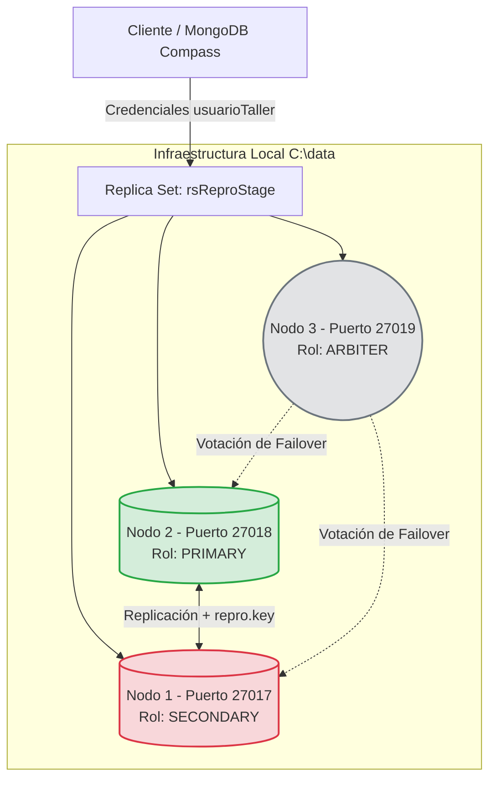

# Fase 3: Resiliencia, Transacciones y Securización - ReproStage

## 1. Arquitectura del Sistema (Replica Set)
Para garantizar la alta disponibilidad del sistema de ReproStage, se migró de un entorno de desarrollo aislado a un clúster distribuido tolerante a fallos de forma local. La topología está compuesta por tres nodos:
- **Nodo 1 (Puerto 27017):** Configurado inicialmente como `PRIMARY`.
- **Nodo 2 (Puerto 27018):** Configurado inicialmente como `SECONDARY`.
- **Nodo 3 (Puerto 27019):** Configurado como `ARBITER` (no almacena datos, solo desempata y participa en las elecciones).



## 2. Bitácora de Failover y Alta Disponibilidad
Se realizó una prueba de estrés para simular la caída abrupta del servidor principal y evaluar la resiliencia de la red. 
1. Durante un proceso activo, se forzó la detención del proceso `mongod` en el puerto 27017.
2. El sistema arrojó el error esperado `ECONNREFUSED 127.0.0.1:27017`.
3. Automáticamente, el nodo Árbitro detectó la ausencia del primario y ejecutó una elección en el clúster.
4. El Nodo 2 (puerto 27018) fue promovido exitosamente a `PRIMARY` (comprobado vía `db.isMaster()`), manteniendo la base de datos online y operativa sin pérdida de servicio.


## 3. Transacciones ACID Multi-documento
Para proteger la integridad de los datos críticos del taller de reprogramación, se implementaron transacciones ACID mediante el manejo de sesiones. Esto asegura que operaciones compuestas (como registrar un nuevo servicio y actualizar el contador del cliente) se ejecuten como una unidad atómica: o se completan todas, o no se guarda ninguna.

**Escenario de Éxito (CommitTransaction):**

```javascript
const sesionNueva = db.getMongo().startSession();
const dbRepro = sesionNueva.getDatabase("ReproStage");
sesionNueva.startTransaction();
try {
  // 1. Registro del servicio
  dbRepro.servicios.insertOne({ cliente: "Juan", vehiculo: "VW Gol", tipo: "Stage 1", fecha: new Date() });
  // 2. Actualización del perfil del cliente
  dbRepro.clientes.updateOne({ nombre: "Juan" }, { $inc: { repros_realizadas: 1 } });
  
  sesionNueva.commitTransaction();
  print("Transacción ACID ejecutada con éxito. Los datos están seguros.");
} catch (error) {
  sesionNueva.abortTransaction();
} finally {
  sesionNueva.endSession();
}
```

**Escenario de Fallo Provocado (Rollback):**

```javascript
const sesionFallo = db.getMongo().startSession();
const dbRepro = sesionFallo.getDatabase("ReproStage");
sesionFallo.startTransaction();
try {
  dbRepro.servicios.insertOne({ cliente: "Pedro", vehiculo: "Ford Focus", tipo: "Stage 2" });
  throw new Error("Regla de negocio violada: Tarjeta rechazada. Cancelando operación.");
  dbRepro.clientes.updateOne({ nombre: "Pedro" }, { $inc: { repros_realizadas: 1 } });
  sesionFallo.commitTransaction();
} catch (error) {
  sesionFallo.abortTransaction();
  print("Rollback ejecutado. Los datos no se guardaron. Motivo: " + error.message);
} finally {
  sesionFallo.endSession();
}
```

## 4. Reporte de Securización (Security by Design)
Históricamente, muchas infraestructuras NoSQL sufrieron ataques de ransomware por configuraciones permisivas por defecto. Para blindar ReproStage, se implementó una política de seguridad estricta:

- **Autorización Obligatoria e Inmunización:** Se configuró el archivo `mongod.conf` utilizando la directiva `security.authorization: "enabled"` junto con un `keyFile` de acceso cifrado inter-nodo. Cualquier intento de conexión anónima a la base de datos es rechazado en la puerta de enlace arrojando el error `Command buildInfo requires authentication`.
- **Principio de Mínimos Privilegios:** Se crearon roles específicos para evitar el uso del administrador general en operaciones cotidianas:
  - **`adminRepro`:** Rol `root` en la base `admin`, de uso exclusivo para mantenimiento de infraestructura.
  - **`usuarioTaller`:** Rol `readWrite` limitado estrictamente a la base de datos `ReproStage`.

